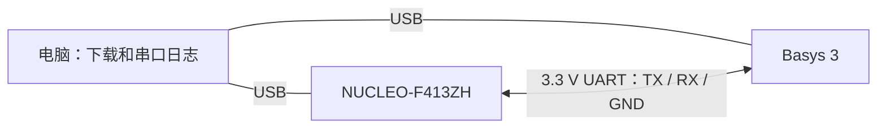
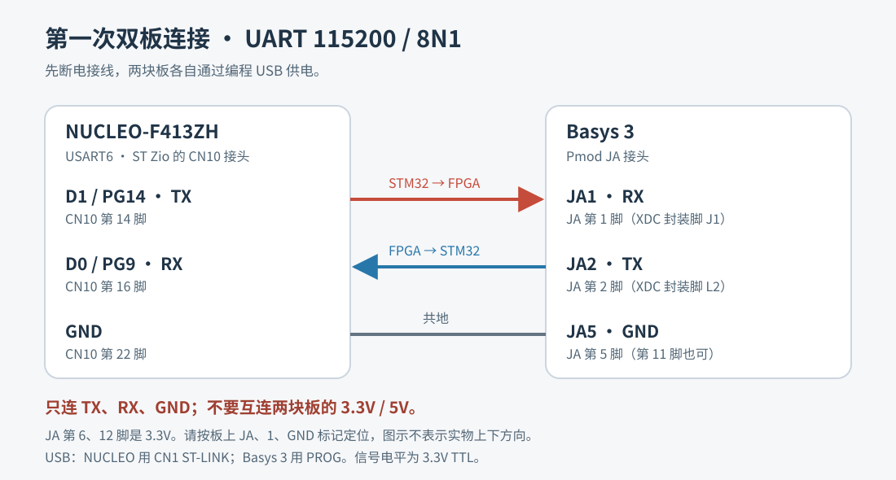

# Basys 3 + STM32 双板 2D 游戏

使用 **Digilent Basys 3** 和 **STM32 NUCLEO-F413ZH**，逐步实现彩色 VGA 2D 游戏。计划由 STM32 处理游戏状态，FPGA 生成画面，两块板通过 UART 交换数据。

**当前阶段：双板 UART 通信初开发。** 已有可编译的两侧源码、串行通信仿真和预编译文件；VGA 绘图、人物移动、地图和音效尚未实现。实体板接线与回包尚未实测。

## 从这里开始

- [接线、CubeMX 配置、下载与故障排查](docs/getting-started.md)
- [FPGA 工程与仿真](fpga/README.md)
- [STM32 / Keil 工程](stm32/README_STM32.md)
- [当前 UART 协议](docs/protocol.md)
- [开发路线](docs/roadmap.md)
- [上传 GitHub](docs/github-upload.md)
- [验证记录](docs/verification/uart-starter-2026-10-27.txt)

## 当前功能

STM32 每 500 ms 发送带序号和 XOR 校验的四字节请求，FPGA 校验后回包；STM32 验证回包，通过 ST-LINK 虚拟串口输出 `PASS`、`TIMEOUT` 等日志。板载 LED 显示心跳、收包及错误状态。



初次测试只需要两块板、两根可传数据的 Micro-USB 线、三根公对公杜邦线；暂时无需屏幕或蜂鸣器。

## 三根接线

先断电，再接线。两块板各自 USB 供电，只连接以下三根线。

| NUCLEO-F413ZH | 方向 | Basys 3 |
|---|---|---|
| D1 / PG14 / CN10-14，USART6_TX | → | JA1，UART RX |
| D0 / PG9 / CN10-16，USART6_RX | ← | JA2，UART TX |
| GND / CN10-22 | — | JA5，GND |

这是 **3.3 V TTL UART**。不要互连两块板的 3.3 V / 5 V 电源脚。JA6、JA12 是电源，不能当作 GND。`J1` / `L2` 是 FPGA 封装脚号，实际接线找 JA1 / JA2。



## 软件与工程入口

| 部分 | 已验证环境 | 入口 |
|---|---|---|
| FPGA | Vivado / XSim 2018.3；`xc7a35tcpg236-1` | `fpga/create_project.tcl` |
| FPGA 有效约束 | 100 MHz、btnC、JA UART、LED | `fpga/constraints/board_link.xdc` |
| STM32 | Keil MDK；ARM Compiler 5.06 update 7 | `stm32/MDK-ARM/nucleo_f413zh_uart.uvprojx` |
| STM32 配置重建 | CubeMX + HAL；HSI 16 MHz | [配置表](docs/getting-started.md#3-cubemx-配置对照) |
| HAL / CMSIS | 随仓库附带所需 STM32CubeF4 1.28.3 文件 | `stm32/Drivers/` |

Keil 工程目标为 STM32F413ZH，设备包为 `Keil.STM32F4xx_DFP.2.15.0`；安装相应设备包和编译器。其他工具版本尚未逐一验证。本仓库没有手写的 `.ioc` 文件，CubeMX 重建步骤见入门文档。

FPGA 脚本只启用 `board_link.xdc`。`Basys-3-Master.xdc` 是完整接口参考，**不要同时加入当前工程**。

## 快速运行

1. 按接线表连接，两块板分别通过编程 USB 口供电。
2. 用 Vivado Hardware Manager 下载 `fpga/prebuilt/board_link_top.bit`，或自行构建。
3. 用 Keil 打开上述 `.uvprojx`，Rebuild；选择 ST-Link Debugger、SW / SWD，下载并运行。
4. 打开 NUCLEO 的 ST-LINK Virtual COM Port：115200、8N1、无流控、文本显示。
5. 正常时每 500 ms 出现 `PASS seq=... data=0x...`；参照入门文档检查 LED 和故障。

重新构建 FPGA，在配置过 Vivado 环境的终端、仓库根目录执行：

```powershell
vivado -mode batch -source fpga/build.tcl
vivado -mode batch -source fpga/sim.tcl
```

Keil 命令行重建：

```powershell
./stm32/build_keil.ps1 -KeilPath 'C:\Keil_v5\UV4\UV4.exe'
```

以上脚本只构建或仿真，不执行硬件下载。详细步骤见[入门文档](docs/getting-started.md)。

## 仓库结构

```text
.
├── fpga/                 Verilog、XDC、Tcl、仿真、预编译 BIT
├── stm32/                HAL/CMSIS、应用、Keil 工程、预编译 HEX
├── docs/                 入门教程、接线图、协议、路线和验证记录
├── scripts/              仓库自检与可选 Icarus 仿真入口
├── .github/              自动检查和 Issue / PR 模板
├── SHA256SUMS.txt        仅校验随仓库保存的 BIT / HEX
└── THIRD_PARTY_NOTICES.md 第三方来源与许可证索引
```

## 验证状态

- XSim：真实 100 MHz / 115200 时序下，正常包、错误校验、部分包超时、波特率偏差、背靠背请求及复位恢复通过。
- Vivado：综合、布局布线和 BIT 生成通过；DRC 0 项，内部 setup WNS +4.410 ns、hold WHS +0.131 ns。
- Keil：完整编译与链接通过，0 错误、0 警告，生成 HEX。
- 实体开发板：尚未连接、下载或实测，不能将以上记录当作板间通信已通过。

GitHub Actions 已配置仓库自检和 Icarus UART 仿真，首次上传后才会在 GitHub 执行；它不替代 Vivado 实现、Keil 链接或实物验证。Windows 本地可执行：

```powershell
python scripts/check_repo.py
# 另需安装 Icarus Verilog，并使 iverilog / vvp 可用：
python scripts/run_hdl_sim.py
```

## 贡献和许可

修改前参阅 [CONTRIBUTING.md](CONTRIBUTING.md)。原创代码暂未指定开源许可证，详见 [LICENSE_STATUS.md](LICENSE_STATUS.md)；第三方文件保留各自许可和版权声明，见 [THIRD_PARTY_NOTICES.md](THIRD_PARTY_NOTICES.md)。
