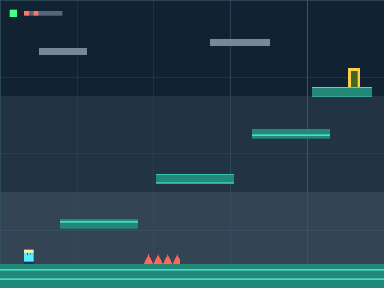

# VGA 横版闯关原型

这一版是单关卡原型：玩家左右移动、跳上平台、避开危险区、到达出口；碰到危险区重生并累计死亡次数，到达出口后显示通关标记。STM32 计算游戏，FPGA 读取板载按键并绘图。

**第一次上板先做 [UART 实物连接测试](hardware-test.md)。** 游戏程序有独立的工程入口，原来的 UART 测试代码和固件仍然保留。

## 两组工程要配对

| 用途 | FPGA 下载文件 | STM32 Keil 工程 |
|---|---|---|
| 当前接线测试 | `fpga/prebuilt/board_link_top.bit` | `stm32/MDK-ARM/nucleo_f413zh_uart.uvprojx` |
| VGA 游戏原型 | `fpga/prebuilt/game_top.bit` | `stm32/MDK-ARM/nucleo_f413zh_game.uvprojx` |

对应 STM32 预编译文件在 `stm32/firmware/`，分别为 `nucleo_f413zh_uart.hex`、`nucleo_f413zh_game.hex`。不要混用两种模式的 BIT / HEX：接线测试是 STM32 发起，游戏模式是 FPGA 发起，回复长度也不同。

## 接线和操作

板间仍然只接 TX、RX 和 GND 三根线，与接线测试完全相同。游戏显示时，将 Basys 3 的 VGA 插座连接到支持 640×480@60 Hz 输入的 VGA 显示设备，并给显示器单独使用匹配电源。

| Basys 3 按键 | 游戏中的作用 |
|---|---|
| L | 向左移动 |
| R | 向右移动 |
| U | 跳跃，需先着地；按住不会连续跳 |
| D | 重开本关，清零死亡次数 |
| C | 复位 FPGA 显示与通信 |

左右同时按下时停止水平移动。通关后用 D 重新开始。STM32 的 RESET 重新初始化游戏；FPGA 的 C 只复位 FPGA，不能代替整局重开。

游戏输入采用板载按键，无需额外购买按键。现有有源蜂鸣器与音效尚未接入这一版。

## 画面与分工



- FPGA：25.2 MHz 像素时钟，800×525 总时序，对应 640×480 可见区域、60 Hz，负极性 Hsync / Vsync，RGB444。
- STM32：用固定点坐标模拟左右移动、重力、跳跃、实心平台碰撞、危险重生及出口通关。
- UART：每帧发送一次按键请求，回传坐标和状态；显示坐标在垂直消隐起点切换，避免半帧出现两种角色位置。
- 关卡：640×480，一块地面、四级平台、一处危险区和一个出口。图形定义来自同一份 [level.json](../game/level.json)。

左上角小方块为通信状态，绿色表示近期收到合法状态，红色表示尚未连接或约一秒没有合法回包。旁边八个小格显示死亡次数的低八位二进制；角色重生会短暂变色，通关会出现绿色标记。

危险图形的碰撞使用保守的矩形区域，包括尖刺外形内的空白部分；这是原型规则。完整协议和异常处理见 [游戏协议](game-protocol.md)。

## 从源码构建

以下命令从仓库根目录运行，需先安装相应工具并配置命令环境：

```powershell
python scripts/generate_level.py --check
vivado -mode batch -source fpga/create_game_project.tcl
vivado -mode batch -source fpga/build_game.tcl
vivado -mode batch -source fpga/sim_game.tcl
./stm32/build_game_keil.ps1 -KeilPath 'C:\Keil_v5\UV4\UV4.exe'
```

游戏综合顶层为 `game_top`，使用 `fpga/constraints/game.xdc`；不要将原 UART 的 `board_link.xdc` 或完整 Master XDC 加入这个游戏工程。具体默认输出目录以脚本结束时显示的路径为准。

共享关卡 JSON 修改后，运行 `python scripts/generate_level.py` 更新 C / Verilog 头，再同时重建两侧程序。初版生成器有意限制关卡槽位及尺寸；扩大地图结构时需同步扩展绘图和测试。

## 软件测试和实物边界

```powershell
python scripts/check_repo.py
python -m unittest discover -s tests -p test_level_generator.py
python stm32/Game/run_tests.py
# 另需 Icarus Verilog：
python scripts/run_game_hdl_sim.py
```

纯 C 测试与 HDL 仿真验证软件行为，Vivado 实现检查器件约束和内部时序。它们不等同于两块实体板、VGA 显示设备、按键及线材已经通过测试。

当前版本尚无菜单、角色动画、多个关卡、背景音乐或独立时钟下的丢包追赶。先完成双板连接，再检查静态 VGA 图像，最后验证按键到角色移动的完整路径。

本次软件回归从出生点只发送按键，在 179 帧内零死亡通关。平台包含底面碰撞，需要提前起跳；测试路线是出生点附近起跳上第一级，之后约在 x190、x350、x460 起跳，最后走到出口。这条回归证明默认关卡可达，不代替按键手感的实物调整。

构建、仿真和软件测试的具体结果见 [游戏验证记录](verification/game-prototype-2026-10-27.md)。
